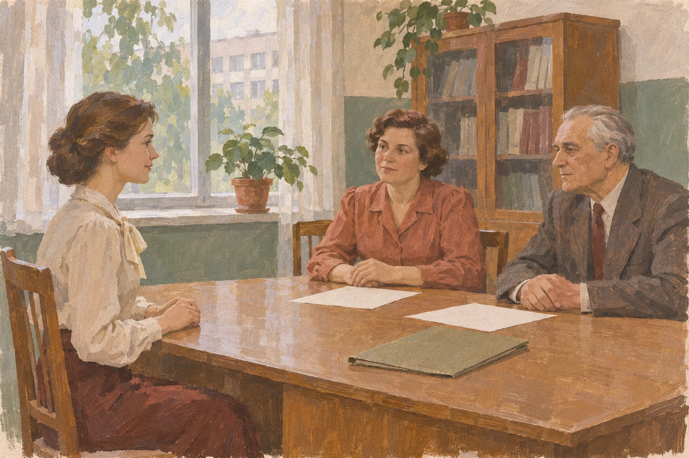
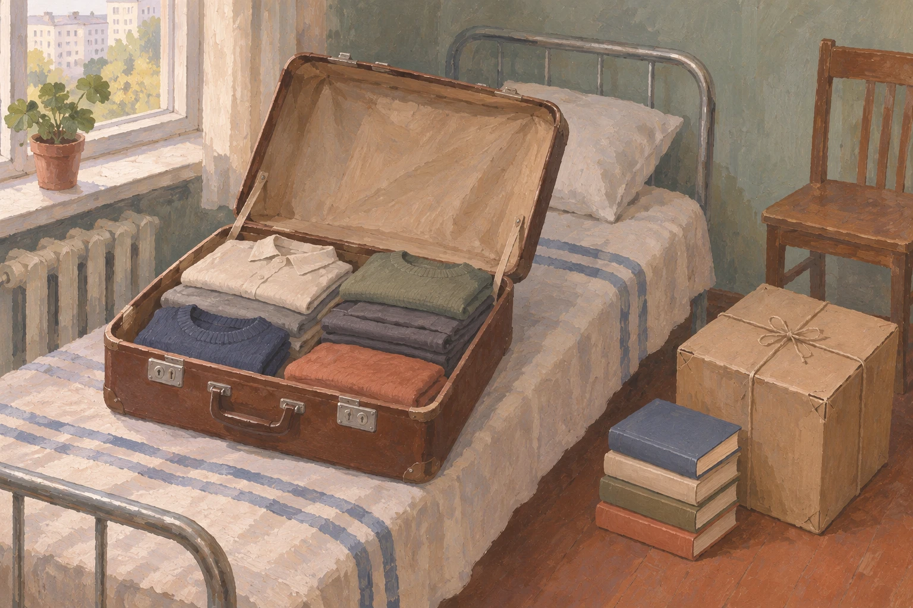

# Работа по распределению: с чего начиналась жизнь в другом городе в 1980-е

В удостоверении о направлении на работу рядом с месячным окладом указывали вид предоставляемой жилплощади и срок прибытия. Документ сообщал не только будущую должность: в нём было место для условий переезда и жизни. Это форма из советского Положения о распределении, введённого с сентября 1980 года, а не восстановленная по памяти семейная история. Рассмотрим начало и середину этого десятилетия — без переноса правил на весь советский период.

За словами «поехал по распределению» легко представить один и тот же сюжет: диплом, чемодан, незнакомый город. Но начало самостоятельной жизни не сводилось к билету. Что молодому специалисту предписывали, что ему обещали и что из этого можно узнать о судьбе конкретного человека?

## Что сообщали до отъезда

Положение требовало работать по назначению не менее трёх лет, за оговорёнными исключениями. При этом комиссия должна была сообщить выпускнику место работы, должность, зарплату и жилищные условия, выслушать его пожелания. Между «пожелания учитывались» и «можно было выбрать любое место» — существенная разница. Первое записано в документе; второго он не обещает.

Обсуждение будущего места работы в вузовском кабинете начала 1980-х. Персонажи вымышлены. Художественная реконструкция.

Был предусмотрен и семейный случай: одновременно выпускающихся супругов следовало направлять в один город или район. Это позволяет увидеть в распределении не только движение кадров по карте. На другом конце назначения могла быть семья, для которой два места работы означали один переезд — или два разных адреса. Само правило не доказывает, что каждую такую ситуацию разрешали без затруднений.

Комиссии полагалось учитывать также специализацию, успеваемость и здоровье выпускника. Значит, чтобы понять конкретное назначение, одного названия вуза недостаточно: нужны обстоятельства, которые в чужой краткой биографии могут вовсе не сохраниться.

## Переезд считали отдельно

Для переезда в другой населённый пункт существовало отдельное постановление Совмина СССР от июля 1981 года. Оно предусматривало оплату дороги работнику и членам семьи, перевозки вещей — до 500 килограммов на самого работника и до 150 на каждого переезжающего члена семьи. Это предел оплачиваемого провоза, а не описание содержимого чемодана обычного выпускника.

Сбор вещей перед переездом: одежда, книги и связанная коробка. Собирательный бытовой сюжет начала 1980-х. Художественная реконструкция.

Предусматривалась и выплата по окладу нового места работы за время пути и за дни сборов и устройства — последних не более шести. В этой норме самостоятельная жизнь выглядит не как мгновенная перемена после вручения диплома: нужно добраться, перевезти вещи, устроиться. Шесть оплачиваемых дней, конечно, не означают, что за шесть дней человек уже осваивался в городе и профессии.

Отдельная тонкость — единовременное пособие. Полный месячный оклад молодым специалистам вводили поэтапно: для Европейского Севера, Сибири и Дальнего Востока с 1982 года, для Урала, Казахстана, Поволжья и Волго-Вятского района с 1983-го, для остальных районов с 1984-го. До соответствующего срока предусматривалась половина оклада; для Крайнего Севера действовала особая оговорка. Поэтому воспоминание «дали пол-оклада» нельзя проверить без года и места назначения.

## Жилплощадь в бланке и жильё в жизни

Слово «жильё» требует осторожности. Положение предписывало обеспечить молодого специалиста изолированным помещением по договору найма, а место в общежитии называло временной мерой. Постановление о переезде отдельно устанавливало обязанность предоставить распределяемому и его семье жилое помещение вне очереди.

Из этого не следует, что каждый приезжавший немедленно получал отдельную квартиру. Перед нами обязанность принимающей стороны, а не отчёт о выданных ключах. Чтобы описать реальный быт, понадобятся свидетельства о конкретном предприятии, городе и человеке. Нельзя дорисовать комнату только потому, что в удостоверении для неё оставили строку.

Предусматривалась и возможность другого направления, если предложенная работа не соответствовала специальности или не обеспечивалась жилплощадь: этим должна была заниматься комиссия с ведома соответствующего ведомства. Наличие такого порядка показывает, что условия назначения имели значение. Но не говорит, насколько часто выпускники добивались перемены и сколько времени это занимало.

## Вместо собирательного героя — одна учительница

О конкретном начале работы рассказывает Татьяна Николаевна Тамонова. Её воспоминание опубликовано управлением образования Советского района в очерке о педагогической династии. По её рассказу, в 1981 году она поступила в педагогический институт в Свердловске, а в 1985-м приехала по распределению в Советский и начала работать во втором классе 14-й железнодорожной школы.

Эта подробность меняет масштаб: не просто выпускница прибыла в новый город, а молодая учительница получила второй класс. Встреча с профессией здесь обозначена яснее, чем бытовые условия. О её комнате, дорожных расходах или разговоре перед отъездом очерк не сообщает. Даже город учёбы нельзя автоматически назвать родным городом: таких сведений в рассказе нет.

Через три года, говорится в том же очерке, Тамонова перешла в детский сад «Родничок». Совпадение с обычным сроком работы по назначению не даёт права объяснить им переход: мотивов источник не раскрывает. Это отдельная биография, сохранённая в позднем воспоминании, а не образец того, как складывалась жизнь у всех молодых специалистов.

После прибытия нового специалиста принимающей организации полагалось в пятидневный срок отправить подтверждение в учебное заведение и своё ведомство. Для системы назначение становилось прибытием, должностью, окладом и обеспечением жилплощадью. Для Тамоновой в её рассказе начало профессии — это второй класс, с которым ей предстояло работать.

Читая семейное воспоминание о распределении, полезно сохранить обе подробности: что человеку полагалось и что он сам рассказал о первом месте. Первая помогает увидеть обязанности принимающей стороны. Вторая не позволяет подменить отдельную судьбу готовым сюжетом о счастливом билете или вынужденном отъезде.
