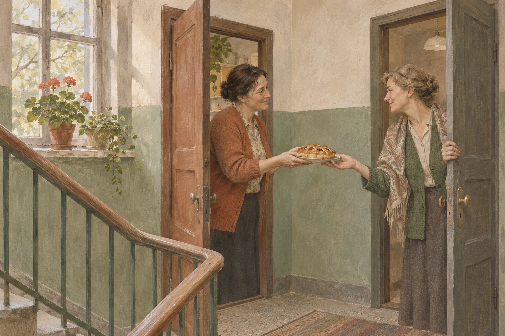
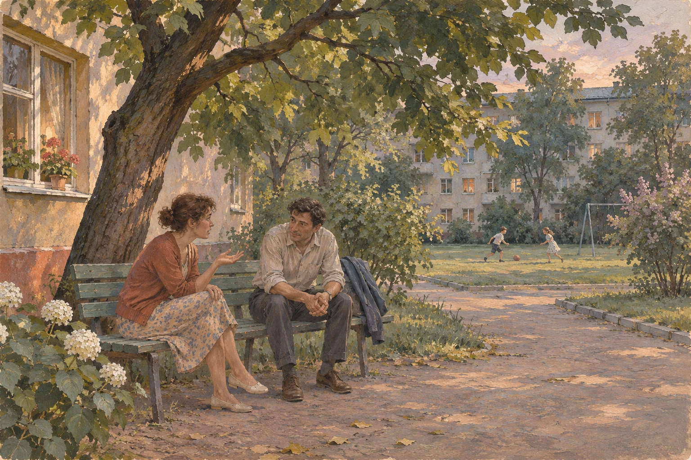
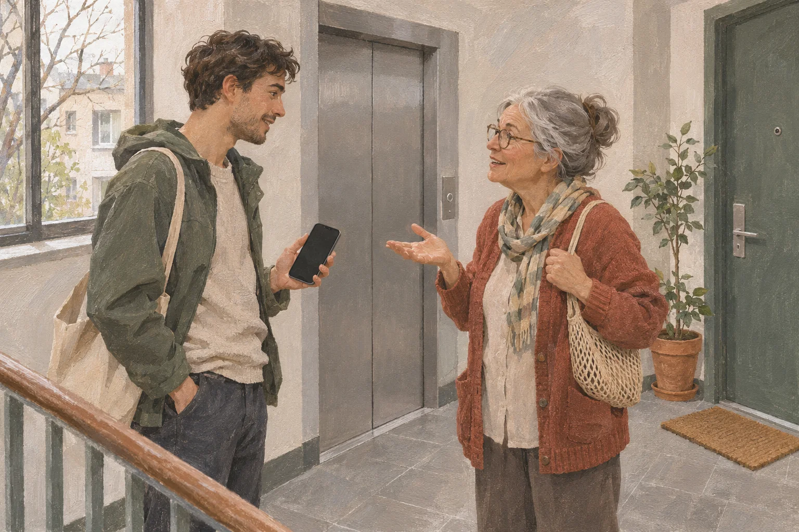

Соседский жест: тарелка с пирогом у дверей двух квартир. Собирательная сцена без точной датировки. Художественная иллюстрация.

<!-- APPROVED_ARTICLE_START -->
# Правда ли раньше люди жили дружнее — или память смягчает прошлое?

Вообразим старый подъезд. Одна соседка держит дверь, другая передаёт тарелку с пирогом. В коридоре пахнет краской, кто-то спускается по лестнице и здоровается. Это не воспоминание конкретного человека и не документальная сцена: такой собирательной картинкой часто удобно объяснить фразу «раньше все были ближе».

Но что именно мы сравниваем? Собственных соседей тридцатилетней давности с незнакомыми жильцами сегодняшнего дома? Или общительность целой страны тогда и сейчас? Между этими вопросами огромная разница. Психологи изучают, почему приятное прошлое становится ещё приятнее в памяти. Социологи — как люди в разные годы описывают отношения и доверие. Смешивать два ответа в один было бы ошибкой.

## Почему прошлый праздник кажется теплее, чем был

В 1997 году исследователи Теренс Митчелл, Ли Томпсон, Эрика Петерсон и Рэнди Кронк сравнили оценки событий до их начала, во время и после. Речь шла не о соседях и не о Советском Союзе: участники оценивали поездку в Европу, отпуск на День благодарения и трёхнедельный велосипедный поход по Калифорнии.

Во всех трёх исследованиях люди ожидали от событий большего удовольствия, чем испытывали по ходу дела. А спустя время вспоминали пережитое в более благоприятном свете, чем оценивали его непосредственно во время поездки или отдыха. Учёные назвали это «розовым» взглядом назад.

Удобно представить тот же механизм во дворе детства. В памяти остались совместные игры и весёлые вечера, а ожидание под дождём, ссора из-за мяча или раздражение взрослых уже не определяют общий тон истории. Это возможная иллюстрация эффекта, а не экспериментальное доказательство того, какими были советские дворы.

Есть и другая находка. Исследователи Ричард Уокер, Джон Сковронски и Чарльз Томпсон описали дневниковые работы, в которых люди записывали события и их эмоциональную окраску по мере происходящего. Спустя месяцы и даже годы оценки повторяли. Отрицательные переживания в среднем теряли интенсивность быстрее положительных. Важно: речь об ослаблении чувства, а не об исчезновении фактов. Неприятную встречу можно помнить прекрасно, но уже не переживать прежнюю досаду.

## Почему в ностальгических воспоминаниях часто есть близкие

В статье 2006 года психологи Тим Уайлдшут, Константин Седикидес, Джейми Арндт и Клей Раутледж объединили семь разных исследований. Сначала они изучали, о чём люди рассказывают, когда вспоминают прошлое с ностальгией. В этих историях часто появлялись близкие: друзья, родные, любимые. Позже учёные проверили, что вызывает ностальгию и как она меняет самочувствие.

В одном из опытов 52 студента случайным образом разделили на две группы. Одну попросили мысленно вернуться к событию, вызывающему ностальгию; другую — вспомнить обычный эпизод недавней жизни. В первой группе участники после задания сильнее ощущали, что их любят и оберегают. Другие эксперименты той же серии также показали усиление субъективного чувства социальной связи.

Получается любопытная петля: мы вспоминаем людей, с которыми были близки, и само воспоминание на время помогает почувствовать близость. Но психолог не подсчитывал, сколько соседей действительно помогали друг другу в разные десятилетия. Он измерял состояние участника после конкретного задания.

К тому же воспоминания не обязаны всех утешать одинаково. В опыте 2015 года участникам сначала показывали грустный фрагмент фильма, а затем предлагали ностальгическое либо обычное воспоминание. Грусть после воспоминания уменьшалась в обеих группах. Но у участников со средней и высокой выраженностью ненадёжной привязанности после ностальгического эпизода она ослабевала меньше, чем после обычного. Поэтому ностальгию нельзя объявлять универсальным способом справляться с грустью.

Двор, который запомнился кому-то тёплым: отдельная сцена не рассказывает обо всех дворах эпохи. Художественная иллюстрация.

## А сколько людей действительно дружили с соседями?

Здесь полезнее отложить альбом и посмотреть на опросы. В исследовании, опубликованном Левада-центром, в 2006 году три тысячи человек спрашивали, как часто они проводят свободное время с друзьями из числа соседей. Почти каждый день — 15% опрошенных, несколько раз в неделю — ещё 23%. Но 26% отвечали «никогда».

Это уже разрушает удобное слово «все». Даже в одном временном срезе люди жили рядом по-разному. При этом цифры относятся к **2006 году**, а не к условному двору 1970-х: подменить одну эпоху другой нельзя.

Другая серия вопросов показывает, как легко ошибиться с самим словом «дружнее». В 1995 году 38% респондентов были *вполне* удовлетворены своим кругом общения — друзьями, соседями, знакомыми и коллегами; ещё 46% — *скорее* удовлетворены. В 2011-м ответы распределились иначе: 31% и 56%. В сумме получаются 84% и 87%, но доля наиболее довольных уменьшилась.

Что считать улучшением? По сумме двух положительных ответов показатели близки. По доле ответа «вполне» есть снижение. А по числу настоящих друзей этот вопрос вообще ничего не сообщает. В таком опросе нельзя разглядеть ни бескорыстный поступок соседки, ни одиночество человека, который формально всем доволен.

## Дверь осталась, способы разговора меняются

У соседства появилась ещё одна форма — домовой чат. В опросе марта 2020 года 28% россиян говорили, что слышали о таких беседах, ещё 6% участвовали в них. Среди обсуждаемых тем были благоустройство и работа управляющей компании. Это не значит, что чат заменил разговор у двери: исследование лишь фиксирует знакомство с новым способом обсуждать общие дела.

Новый способ связи не отменяет разговор лицом к лицу: встреча у лифта в современном подъезде. Художественная иллюстрация.

Нельзя подменять соседскую дружбу и общей настороженностью в отношениях с людьми. Например, в опросе 2024 года 17% респондентов считали, что людям можно доверять, а 82% полагали, что осторожность не помешает. Вопрос задан о людях вообще. Он не показывает, даст ли конкретный сосед запасной ключ или поможет донести тяжёлую сумку.

Так складывается важное ограничение. Опросы 1995, 2006, 2011, 2020 и 2024 годов измеряли разное: удовлетворённость общением, совместный досуг, использование чатов и общее доверие. Из этих чисел нельзя построить честный график «раньше дружелюбие было выше». Для сравнения с советским временем понадобились бы сопоставимые вопросы, заданные тогда и повторённые позднее, с учётом возраста, места и условий жизни.

## Что остаётся от слов «раньше были дружнее»

У человека могут быть совершенно подлинные воспоминания о дворе, где помогали с детьми, носили друг другу книги или собирались по вечерам. Не нужно их обесценивать: пережитая поддержка реальна для того, кто её получал. Но одну личную историю нельзя умножить на целую эпоху.

Возможно, фраза «люди раньше были дружнее» иногда говорит не столько о стране, сколько о конкретных людях, рядом с которыми нам было спокойно. Память сберегает важные отношения, а со временем может менять эмоциональное освещение событий. Она хороший проводник в собственное прошлое — но не готовый переписной лист соседской доброты. Чтобы понять, какими были отношения тогда и какие они сегодня, нужны и воспоминания, и документы, и вопросы, на которые отвечали сопоставимым образом.
<!-- APPROVED_ARTICLE_END -->

<!-- DZEN_POLICY_RISK: AI_GENERATED_TEXT -->

## Происхождение и ограничения
Текст и иллюстрации полностью созданы с помощью ИИ. Требования Дзена могут запрещать такие тексты, и публикация, модерация и монетизация не гарантированы.
