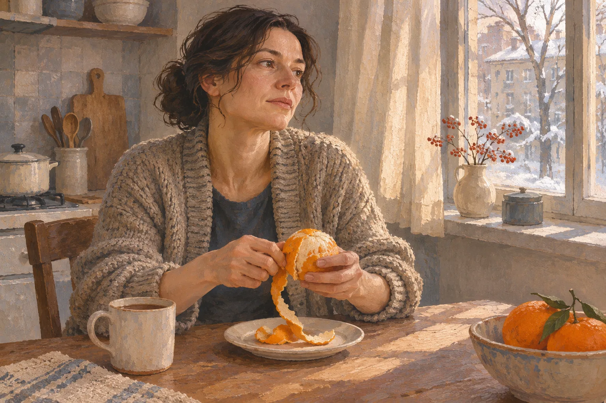
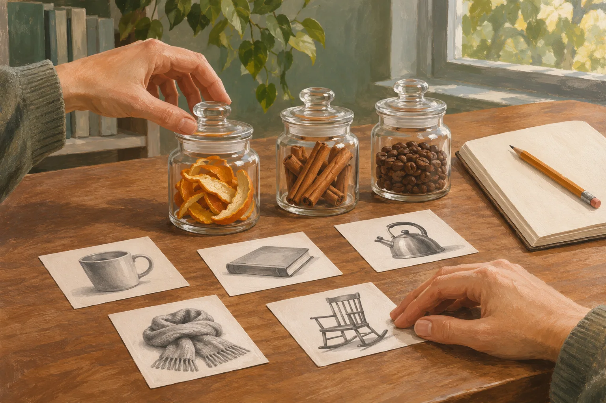
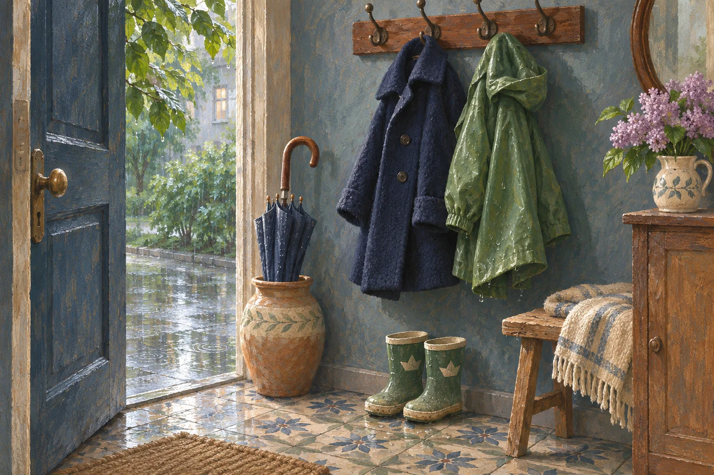

Запах очищенного апельсина как повод вспомнить давно забытый домашний эпизод. Художественная иллюстрация.

<!-- APPROVED_ARTICLE_START -->
# Почему запах апельсина вдруг возвращает в детство — и всегда ли это работает?

Человек чистит апельсин на собственной кухне. Кожура сворачивается длинной лентой. И вдруг вспоминается не рецепт и даже не вкус, а чужая, давно забытая кухня: окно, свет на скатерти, голос из соседней комнаты. Это вымышленная сцена, но узнаваемое переживание у неё вполне реальное — запах иногда словно сокращает расстояние между сегодняшним днём и давним событием.

Почему именно запах? И правда ли он возвращает прошлое точнее и ярче, чем фотография? Исследователи проверяют этот вопрос уже несколько десятилетий. Ответ оказался интереснее простого «да».

## Как учёные ищут воспоминания по запаху

Для психолога личное, или автобиографическое, воспоминание — не просто знание о прошлом. Это эпизод собственной жизни, который человек может соотнести с каким-то временем и местом. Чтобы изучать такие эпизоды, участникам предлагают подсказки: слово, картинку, звук или запах — и просят рассказать, что вспомнилось.

В 2006 году психологи Йохан Вилландер и Мария Ларссон провели опыт с 93 пожилыми людьми. Одним показывали слова, другим — картинки, третьим давали почувствовать запахи. У воспоминаний обнаружилась необычная разница в возрасте: события, вызванные запахами, чаще относились к первым десяти годам жизни. При словесных и зрительных подсказках пик приходился на более поздний период — примерно от 11 до 20 лет.

Участники, вспоминавшие по запаху, также сильнее описывали чувство, будто они снова оказались в прошлом. Но речь шла об оценках людей в определённых условиях эксперимента. Из них нельзя заключить, что любой взрослый обязательно вспомнит детство от запаха мандарина, мокрой одежды или старой книги.

Сопоставление запаховых и зрительных подсказок в исследовании памяти. Художественная иллюстрация.

## Даже название меняет то, что мы вспоминаем

Через год те же исследователи предложили 72 пожилым участникам три разных условия. В одном люди чувствовали запах без подсказки, в другом видели его название, в третьем получали запах вместе с названием. Выяснилось, что знакомое слово способно изменить результат: когда запах называли, выраженный «пик» воспоминаний из детства ослабевал. Менялись и оценки приятности, и ощущение возвращения в пережитый момент.

Это важная подробность. Кажется, будто запах действует совершенно независимо от мыслей и слов. Но даже простая подпись к нему меняет путь, по которому человек ищет событие в собственной памяти. Вспомнить аромат — не то же самое, что прочитать его название.

Здесь нет загадочного особого хранилища детства. Запах становится одной из подсказок, а то, как мы её узнаём и называем, тоже влияет на ответ.

## Почему чувство такое сильное

Обоняние тесно связано с системами мозга, участвующими в обработке эмоций и памяти. Этой особенностью часто объясняют внезапность запаховых воспоминаний. В раннем опыте Рэйчел Херц и Джонатана Скулера люди эмоциональнее оценивали знакомые личные события, когда получали связанную с ними запаховую подсказку, чем при зрительном или словесном напоминании.

Однако фраза «запах напрямую включает прошлое» слишком упрощает работу памяти. Мозг не воспроизводит воспоминание как неизменный фильм, а в опытах исследователи измеряют разные вещи: насколько событие приятно, насколько оно волнует, как сильно человек чувствует возвращение во время события и сколько подробностей может назвать.

Эти показатели могут не совпадать. Человек способен сильно растрогаться — и при этом с трудом восстановить последовательность того дня. Сильное переживание само по себе не удостоверяет точность деталей.

## Новый обзор уточнил красивую легенду

В октябре 2026 года исследователи Овидиу Бобей, Драгош Чырнеч и Иоана Подина опубликовали метаанализ: они собрали результаты 18 экспериментальных и квазиэкспериментальных исследований с общим участием 1330 человек и сравнили семь особенностей личных воспоминаний.

В среднем запаховые подсказки действительно имели преимущество по четырём параметрам: воспоминания оценивали как немного более эмоциональные и приятные, они чаще сопровождались чувством «я снова там» и относились к более раннему возрасту. Но преимущество было не всеобъемлющим. По яркости, конкретности и редкости воспоминаний убедительного общего превосходства запахов обнаружено не было.

Разница принципиальна. «Сильнее тронуло» — не значит «вспомнил больше подробностей». «Чаще ведёт в детство» — не значит «каждый раз». Вывод о более раннем возрасте воспоминаний авторы считают предварительным: исследования по-разному измеряли возраст таких эпизодов, и не все результаты удалось объединить. Есть и другие ограничения — небольшой объём данных для отдельных сравнений и возможное влияние того, какие именно запахи учёные выбрали для опыта.

Так что привычная история о волшебной силе ароматов не выдумана, но сильно преувеличена, если рассказывать её без оговорок.

## Секрет не только в запахе, но и в прожитой жизни

В эксперименте 2018 года исследователи Маайке де Брёйн и Михаэль Бендер проверили 170 участников. Важен оказался не просто способ напоминания, а связь подсказки с детством. Запахи, которые относились к детскому опыту участников, вызывали более богатые воспоминания, чем выбранные для сравнения изображения или стимулы без такой связи.

Можно представить мокрый плащ в прихожей, смесь запахов дождя и шерсти. Для одного человека это напоминание о возвращении домой после школы; для другого — ничего особенного. Сама картинка здесь — художественный пример, не установленный учёными «универсальный запах детства». Личные ассоциации различаются, и исследовательский результат не заменяет конкретную биографию.

Влажная одежда в прихожей: одна и та же бытовая деталь может быть разной подсказкой для памяти. Художественная иллюстрация.

Есть и обратная сторона. Запах не всегда помогает вспомнить больше, чем фотография. В исследовании 2021 года, где сравнивали зрительные, звуковые и запаховые стимулы у молодых, пожилых и людей с болезнью Альцгеймера, изображения в целом чаще вызывали личные воспоминания. Это не отменяет предыдущие опыты — просто показывает, насколько многое зависит от задачи, возраста, здоровья и условий сравнения.

И, возможно, именно поэтому внезапно вернувшееся детство кажется особенно ценным. Его не вызвать по заказу одним и тем же способом. Обычная апельсиновая кожура ничего не обязана нам напоминать. Но иногда она становится точной для одного человека подсказкой — не доказательством, что прошлое было лучше, а поводом снова заметить отдельный эпизод собственной жизни.
<!-- APPROVED_ARTICLE_END -->

<!-- DZEN_POLICY_RISK: AI_GENERATED_TEXT -->
## Происхождение и ограничения
Текст и иллюстрации полностью созданы с помощью ИИ. Требования Дзена могут запрещать такие тексты, и публикация, модерация и монетизация не гарантированы.
