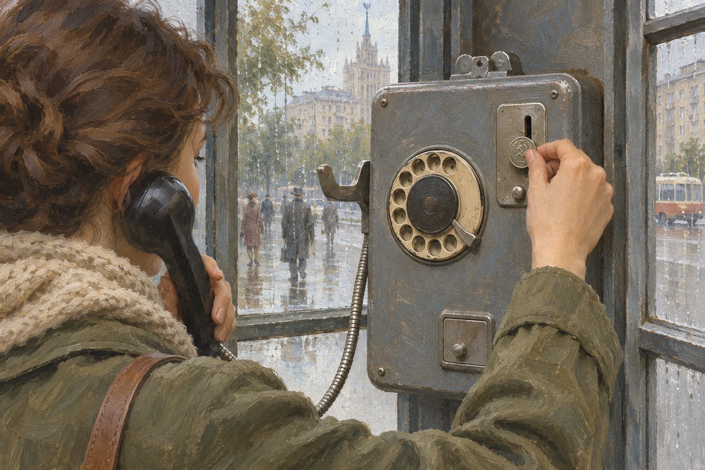
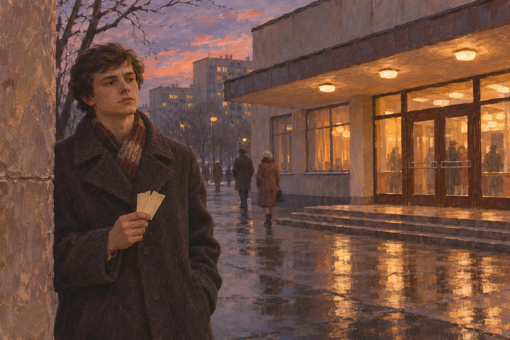

# Свидание без мобильного: что делали, если человек опаздывал?

Представьте условленное место у кинотеатра. Один человек уже пришёл, второй задерживается. Сегодня можно отправить короткое сообщение: «Автобус стоит, буду через десять минут». В советском городе 1980-х такой возможности на улице обычно не было. У встречи были точные координаты — место и время, — а вот узнать, почему второй человек не пришёл, было гораздо сложнее.

Значит ли это, что свидания постоянно срывались? Нет. Но опоздание превращало привычный сейчас вопрос «ты где?» в маленькую задачу без простого ответа.

## Договориться — ещё до выхода из дома

О встрече условливались лично или по телефону, если он был доступен. В ретроспективном материале «Москва 24» о свиданиях 1980-х именно эти способы названы обычными для московской городской жизни. После разговора оставалось запомнить договорённость: не просто «у метро», а с какой стороны выхода и во сколько.

Как предлагали договариваться современникам? В ленинградском сборнике «Советский этикет» 1972 года автор главы об отношениях мужчин и женщин Л. Я. Верб советовал при знакомстве ограничиться номером телефона либо условиться о встрече в людном месте, не сообщая сразу домашний адрес.

Здесь важна оговорка: книга учила правилам поведения. Она не доказывает, что все пары выбирали людные места, и уж тем более не показывает, сколько людей по-настоящему следовало этому совету.

## Почему нельзя было просто позвонить?

«Не было мобильных» — только часть ответа. Домашние телефоны тоже имелись далеко не везде. По советскому статистическому сборнику, в 1980 году к сети общего пользования относилось 11,8 миллиона домашних аппаратов, в 1985-м — 17,1 миллиона. В городах СССР на тысячу жителей в 1980 году приходилось 57 домашних аппаратов, пять лет спустя — 81.

Эти числа не стоит переводить в долю семей: в сборнике считали аппараты, а не домохозяйства. И речь идёт обо всём СССР, где условия Москвы, небольшого города и села могли сильно различаться. Сама статистика, однако, объясняет, почему обещание «позвоню тебе домой» было доступно не каждой паре.

Даже если у обоих имелись телефоны, после выхода на улицу ситуация менялась. Домашний аппарат оставался в квартире. Его нельзя было достать из кармана, чтобы сообщить о пробке или изменившемся маршруте. Поэтому заранее согласованные детали встречи становились важнее.

## Две копейки и телефонная будка

Если человек задерживался, оставался городской таксофон. Виртуальный музей связи описывает советский аппарат с диском и устройством, которое принимало плату за разговор. В привычной музейному описанию системе звонок стоил две копейки.

Это не была прямая линия к опаздывающему. Нужно было найти исправный автомат, знать номер и надеяться, что кто-нибудь ответит на том конце провода. Если человек уже вышел из дома, звонок туда не сообщал, где он находится сейчас. А если телефона дома вообще не было, сам способ отпадал.

*Уличный телефон-автомат и монета для городского звонка. Художественная реконструкция.*

В статье «Москва 24» среди возможных действий в такой ситуации упоминаются попытка позвонить из будки, записка, переданная позже, и ожидание на месте. Это не инструкция, по которой поступали все, а примеры из ретроспективного рассказа о городской жизни.

## А сколько времени полагалось ждать?

Чёткого общего правила на пять, десять или пятнадцать минут источники не дают. Идея, что опаздывать было «принято ради приличия», тоже не подтверждается самим учебником поведения.

Напротив: в том же «Советском этикете» 1972 года автор считал невежливым заставлять другого долго ждать. При этом там же предлагалась довольно строгая ролевая схема: мужчина первым приглашает и приходит, а выбор места и времени оставляет женщине. Современному читателю такой совет может показаться устаревшим. Но важно другое: уже тогда опоздание рассматривали как вопрос уважения к чужому времени.

Книга описывает **идеал поведения**, а не объективный порядок всех свиданий. Журналистская ретроспектива «Москва 24», напротив, рассказывает о случаях долгого ожидания, иногда под дождём и снегом. Между рекомендацией и прожитым опытом была дистанция — как и сегодня.

*Ожидание встречи возле кинотеатра в советском городе 1980-х годов. Художественная реконструкция.*

## Если так и не встретились

Неудачная встреча могла закончиться по-разному. Кто-то уходил домой. Кто-то ждал дольше. Кто-то пытался связаться позднее и объяснить причину. Имеющиеся источники не позволяют подсчитать, какой вариант встречался чаще, поэтому приписывать всем единый «кодекс ожидания» было бы неправильно.

Зато понятен сам узел проблемы. Когда два человека уже отправились к месту свидания, связь между ними обычно прерывалась до момента встречи. Одна неожиданная задержка могла превратить ясную договорённость в неопределённость для обоих — и ни у одного не было способа мгновенно её снять.

Сегодня такое опоздание решается сообщением, картой или звонком. Тогда приходилось больше полагаться на точность предварительной договорённости, доступный телефон и готовность другого человека подождать. Это не означает, что люди любили сильнее или были терпеливее. Просто романтическая встреча зависела от вещей, о которых теперь редко задумываются: работающего автомата, известного номера и двух людей, пришедших в одно место к одному времени.
