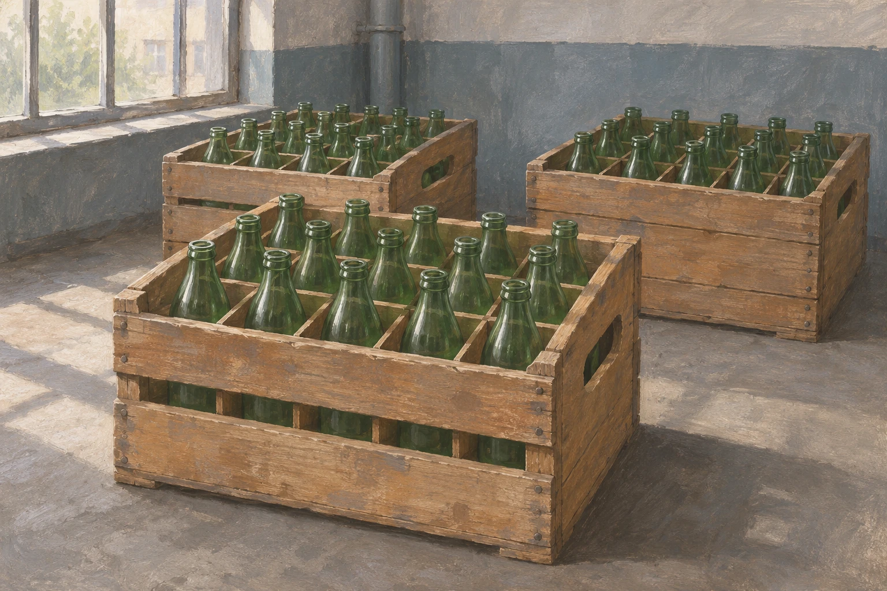
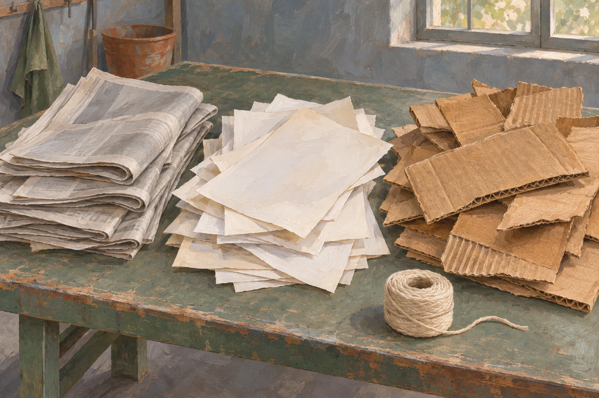

# Бутылка и пачка газет: зачем в СССР собирали стеклотару и макулатуру

Пустая молочная бутылка рядом со стопкой старых газет — условный натюрморт советского быта. Из дома их можно было вынести вместе, но дальше пути расходились. Бутылку старались сохранить бутылкой. Бумагу собирали ради материала, из которого предстояло сделать что-то новое. За знакомым словом «сдать» стояли две разные хозяйственные задачи.

Документы 1970–1980-х годов позволяют восстановить эту цепочку от приёмного окна до производства. Речь пойдёт именно об устройстве и требованиях системы: они не доказывают, что в каждом городе приём работал одинаково исправно.

## Не любое стекло

По правилам Минторга СССР 1984 года стеклотару принимали специальные пункты и продовольственные магазины. При этом магазин принимал тару из-под товаров своего предусмотренного ассортимента. Это не было обещанием взять любую стеклянную вещь, которую принесли из дома.

Важны были пригодность и залоговая цена. Трещины, сколы, посторонние запахи, остатки металлических колец и фольги на горлышке попадали в перечень причин отказа. Но документ не требовал музейной безупречности: некоторые осадки от напитков допускались, как и несмытая этикетка на консервной банке. Приёмка отличала допустимые следы прежнего использования от повреждений и загрязнений.

У пункта должна была быть витрина образцов с залоговыми ценами. За принятую тару полагались наличные по действующему прейскуранту; требовать взамен обязательной покупки товаров запрещалось. Сдающий мог уйти с деньгами, ничего не покупая. Универсального тарифа «за бутылку» эти правила не задают: цены нужно было сверять по виду тары.

## После приёмного окна

На предприятии история пустой бутылки продолжалась. Инструкция Минпищепрома СССР 1980 года прямо ставила задачу увеличивать многократность использования тары. Возвратные бутылки и банки считали по фактическому количеству годных единиц. Это принципиальное отличие от кучи стеклобоя: ценность сохранялась в самой пригодной ёмкости, а не только в стекле как материале.

Целые бутылки в ящиках на тарном складе перед дальнейшей обработкой. Художественная реконструкция.

Движение тары между складом и производством требовало учёта. Отдельно оформляли бой, в том числе возникавший при химической мойке. За простым бытовым действием стояли хранение, погрузка, проверка и обработка на предприятии. Сохранить бутылку дома целой было недостаточно: её нужно было не разбить и на следующих участках пути.

Многократное использование было целью, а не гарантированной судьбой каждой бутылки: сам учёт боя напоминает, что часть ёмкостей выбывала из оборота. Число повторных розливов по этой инструкции установить нельзя.

## Бумага меняла форму

У макулатуры была другая роль. Постановление Совмина СССР 1970 года о вторичном сырье предусматривало её использование для производства бумаги и картона. Газету не собирались снова продавать как тот же номер. Нужен был материал, а значит — заготовка, сортировка и дальнейшая переработка.

Документ полезен и неожиданной бытовой подробностью. В нём предусматривались приёмные пункты из расчёта один на пять–шесть тысяч жителей, ответственные за сбор в жилищно-эксплуатационных конторах и места временного хранения. Это нормативная схема, а не доказательство, что возле каждого дома действительно находился работающий пункт. Но она показывает: сбор нельзя было построить на одном призыве беречь бумагу. Требовались помещения и люди, которые передадут её дальше.

Бумага и картон на сортировочном столе: вторсырьё нужно подготовить к переработке. Художественная иллюстрация.

Что скрывалось за словом «переработка», видно на конкретном примере. Санитарные правила 1986 года для бумаги и картона с макулатурой, предназначенных для упаковки сухих пищевых продуктов, описывали сортировку по маркам, очистку массы, тепловую обработку и сушку. Это уже не связка газет, а производственный материал с новыми требованиями.

В тех же правилах были ограничения по качеству и предусмотрен отбор заводских проб раз в смену. Не вся макулатура шла в пищевую упаковку, и этот документ не описывает весь выпуск бумажной промышленности. Он позволяет увидеть другое: собранное сырьё не становилось готовым изделием сразу после взвешивания. Между сдачей и новой вещью лежал технологический процесс.

Был и стимул, не сводившийся к цене бумаги. Исследователь Илья Полетаев в статье об экономии ресурсов приводит советскую практику: двадцать килограммов макулатуры позволяли купить дефицитную книгу. Дома собирали материал, а встречным интересом становилось чтение. Но право покупки не означало бесплатного получения тома; этот пример не описывает продажу любой книги в любом городе.

## Не проверка на добродетель

Зачем же собирали? Для хозяйства — чтобы вновь использовать пригодную тару и вернуть бумажный материал в производство. Для сдающего система предусматривала понятный встречный интерес: деньги за стеклотару; в случае книжного стимулирования — доступ к покупке издания. Само постановление о вторсырье связывало закупочные цены с заинтересованностью населения в сдаче качественного, рассортированного материала.

По этим требованиям нельзя судить, были ли прежние поколения бережливее нынешних. Зато видна зависимость, которую легко упустить в воспоминаниях: сохранить бутылку или отложить газеты имело практический смысл, если дальше их принимали и передавали получателю.

У бутылки старались сберечь готовую форму, у бумаги — использовать материал заново. Между домашней полкой и промышленностью нужны были место приёма, расчёт и перевозка. Без этой связи даже аккуратно сложенные вещи оставались бы дома.
