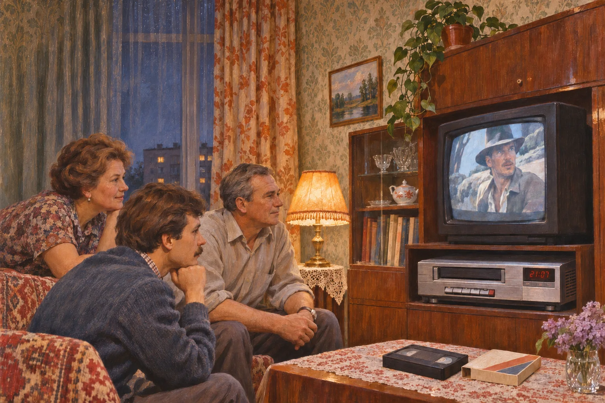
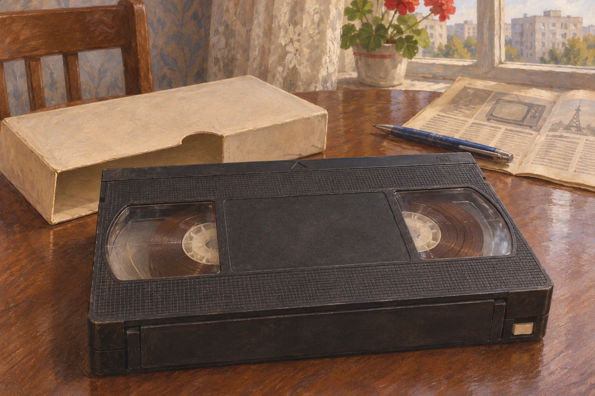
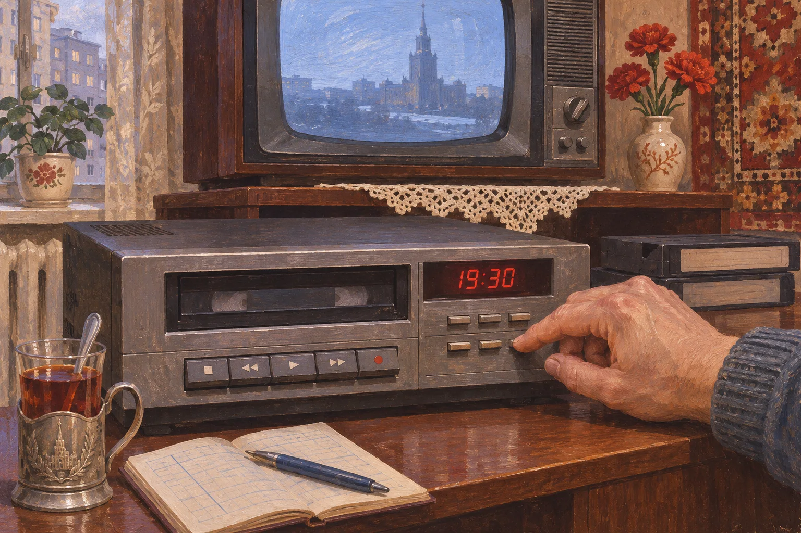

*Домашний просмотр записи на видеомагнитофоне в конце 1980-х годов. Художественная реконструкция.*

<!-- APPROVED_ARTICLE_START -->
# Первый видеомагнитофон дома: как кассета меняла семейный вечер

Представим квартиру в конце 1980-х. Под телевизором появился второй, непривычно большой прибор. В него ставят чёрную кассету, нажимают клавишу — и на экране идёт передача, которую показывали несколько часов назад. Сцена условная, но сама возможность совершенно реальна: домашняя видеозапись позволяла смотреть не только то, что идёт в эфире прямо сейчас.

Сегодня трудно заметить важность этой перемены. Мы привыкли выбирать время просмотра. Когда телевизионная программа шла по расписанию, пропущенный эфир было не так просто вернуть. Видеомагнитофон впервые дал части зрителей инструмент, чтобы это расписание подвинуть.

## Какой прибор оказался под телевизором

В середине 1980-х в СССР выпускали кассетный видеомагнитофон «Электроника ВМ-12». Музеи техники называют его первым серийным отечественным бытовым аппаратом формата VHS. Начало производства обычно датируют 1984 годом; отраслевой журнал «Киномеханик» в 1986-м уточнял, что для розничной продажи модель выпускают с 1985-го.

Это важное различие. Видеозапись в стране существовала задолго до ВМ-12, в том числе на телевидении. Новизна конкретно этой модели — привычный позднее бытовой формат VHS и возможность пользоваться кассетой дома. Но дата начала продаж ничего не говорит о том, сколько советских семей смогли купить такой аппарат. Превращать одну заводскую модель в картину всей страны было бы ошибкой.

Сам прибор не заменял телевизор. Он подключался к нему, принимал телевизионные программы, сохранял изображение и звук на магнитной ленте, а затем отправлял запись на экран. В музейных коллекциях сохранились корпуса, кабели и руководства: за будущим удобством стояла вполне ощутимая техника, требовавшая места и настройки.

## Что помещалось внутри чёрной кассеты

Видеокассета VHS отличалась от знакомой аудиокассеты размерами: это была крупная прямоугольная коробка с двумя катушками магнитной ленты. Отраслевой журнал 1986 года описывал отечественные варианты ВК-30, ВК-120 и ВК-180 — с разной продолжительностью записи. Кассета позволяла загружать ленту в аппарат без ручного продевания её через весь механизм.

*Видеокассета с двумя катушками магнитной ленты. Художественная реконструкция.*

У кассеты была и другая особенность: запись можно было стереть новой. Руководство ВМ-12 прямо предупреждало, что при записи следующей программы прежняя исчезает. Если владелец хотел сохранить уже записанное, рекомендовалось удалить небольшую блокировочную пластинку на корпусе кассеты. Эта деталь превращала вопрос «оставить или записать поверх?» в физическое действие.

Получалась не бесконечная библиотека фильмов. Продолжительность ограничивалась самой лентой, кассету приходилось перематывать, а для нескольких записей нужно было решать, чем пожертвовать. По устройству кассеты мы видим возможность выбора, но не можем определить, что именно хранилось на полках каждой семьи.

## Передачу можно было смотреть не вовремя

Самое любопытное в заводской инструкции «Электроники ВМ-12» — не обещание высокого качества, а раздел про таймер. Аппарат позволял заранее назначить начало и конец записи в пределах следующих четырнадцати суток. Можно было уйти по делам, оставив видеомагнитофону задачу записать нужную передачу. В инструкции описана даже запись одной программы, пока на телевизоре смотрят другую.

*Настройка времени записи на домашнем видеомагнитофоне. Художественная реконструкция.*

В этом и состояла главная перемена для домашнего вечера. Если кассета и прибор были доступны, просмотр переставал быть жёстко привязанным к часу телевизионного эфира. Семья могла договориться включить запись позже, остановить её или пересмотреть понравившийся фрагмент. Это описание технических возможностей, а не свидетельство о том, что так поступали все владельцы.

При этом видеомагнитофон не создавал передачи и фильмы сам. Нужно было заранее записать эфир или получить готовую кассету. В инструкции даже содержалось отдельное упоминание проката видеокассет по предъявлении руководства с гарантийным талоном. Оно показывает, что такой способ получения записей предусматривался, но не доказывает существование доступного видеопроката возле каждого дома.

## Удобство, ради которого читали инструкцию

Воспоминания о старой технике нередко оставляют за кадром её капризы. А в подлинном руководстве к ВМ-12 им уделено немало места. Требовалось настроить приём каналов, при необходимости подправить изображение ручкой трекинга, беречь кассету от пыли и сырости. После перевозки зимой завод советовал дать аппарату и кассете прогреться несколько часов, прежде чем включать их в работу.

Если запись по таймеру не получалась, инструкция предлагала проверить часы, кнопки, канал, положение переключателей и даже целостность пластинки защиты на кассете. То, что теперь выполняется одним нажатием на экране, тогда могло потребовать внимательного изучения передней панели.

Музей МГУ отмечает и другую деталь: «Электроника ВМ-12» использовалась не только дома, но также на региональных и учебных телестудиях. Поэтому историю модели нельзя сводить к одной картинке семейного киносеанса. Устройство существовало сразу в нескольких средах, а домашний просмотр был лишь одной из них.

Первый видеомагнитофон не обязан был превращать каждый вечер в праздник и не делал всё советское телевидение доступным по запросу. Но там, где он появлялся, менялась сама возможность зрителя: передачу можно было сохранить, отложить и посмотреть ещё раз. Между эфиром и человеком возникала кассета — предмет с ограниченной длиной ленты, кнопками, настройками и неожиданной для своего времени свободой выбирать час просмотра.
<!-- APPROVED_ARTICLE_END -->

<!-- DZEN_POLICY_RISK: AI_GENERATED_TEXT -->

## Происхождение и ограничения
Текст и иллюстрации полностью созданы с помощью ИИ. Требования Дзена могут запрещать такие тексты, и публикация, модерация и монетизация не гарантированы.
